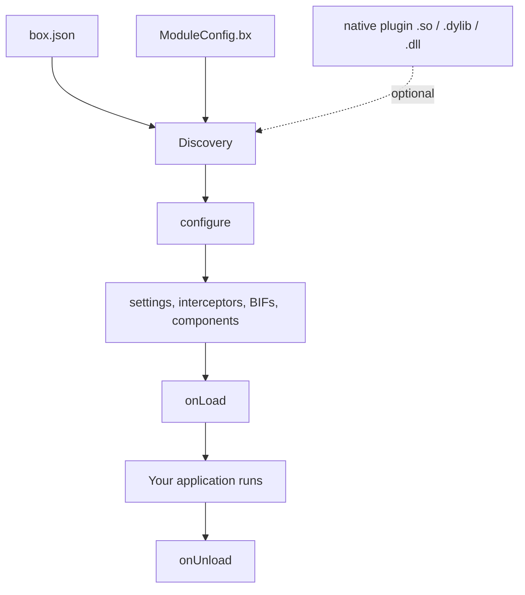

Modules add reusable functionality to MatchBox: functions, member functions, components, interceptors, classes and settings. A module is a normal BoxLang package, so the same package can work on MatchBox and on BoxLang for the JVM.

!!! info "Using or building?"
    To install and use existing modules, start with [Using Modules](using-modules.md). This section mostly covers *building* them.

## Choose your approach

=== "Pure BoxLang"
    No compiling and no toolchain. Write `.bx` and `.bxs` files and MatchBox loads them.

    **Best for:** utilities, wrappers, configuration, components and event listeners.

    - BIFs and member functions
    - Components (`bx:name` tags)
    - Interceptors and custom interception points
    - Settings and application overrides
    - Mappings and packaged classes

    [Start with pure BoxLang](getting-started.md)

=== "BoxLang + Rust"
    Prebuild a Rust native plugin with the MatchBox Plugin SDK and ship it inside the module.

    **Best for:** performance-critical code, binary data, Rust crates and operating system APIs.

    - Everything from pure BoxLang
    - Native functions written in Rust
    - Native objects with member methods
    - Arrays, structs and binary data across the boundary
    - Bundled shared libraries

    [Start with native plugins](native/index.md)

## What modules can provide

::: columns
::: column
**BoxLang**

- **BIFs:** global functions
- **Member functions:** `"text".greet()`
- **Components:** `bx:banner` tags
- **Interceptors:** event listeners
- **Settings:** with application overrides
- **Mappings:** `bxModules.<name>` classes
:::
::: column
**Native (Rust)**

- **Native BIFs:** registered by the plugin
- **Native objects:** with method mappings
- **Class providers:** `java:` class names backed by MatchBox code
- **Binary values:** bytes without UTF-8 copies
- **Shared libraries:** bundled and verified
:::
:::

## How it fits together

MatchBox discovers modules before your program starts, configures them in dependency order, registers what they provide, then calls `onLoad()`. When you build a [native binary](../building-and-deploying/native-builds.md), the module's classes, BIFs and native plugin are embedded in the binary.

## Quick navigation

| Topic | Description |
| --- | --- |
| [Using Modules](using-modules.md) | Install, select and configure modules |
| [Getting Started](getting-started.md) | Build your first module step by step |
| [Module Descriptor](module-descriptor.md) | `box.json`, `ModuleConfig.bx` and injected references |
| [Lifecycle](lifecycle.md) | Discovery, configuration, loading and unloading |
| [Mappings](mappings.md) | `this.mapping`, public folders and packaged classes |
| [Capabilities](capabilities/index.md) | BIFs, components, interceptors and class providers |
| [Native Plugins](native/index.md) | Write a Rust backend with the Plugin SDK |
| [Dual Modules](dual-modules.md) | One package for the JVM and MatchBox |
| [Packaging and Publishing](packaging-publishing.md) | Build artifacts, zip and publish to ForgeBox |
| [JVM Differences](jvm-differences.md) | What MatchBox modules support today |
| [Troubleshooting](troubleshooting.md) | Common errors and fixes |

## Example modules

| Module | Type | What it shows |
| --- | --- | --- |
| [bx-matchbox-std](https://github.com/ortus-boxlang/matchbox/tree/develop/modules/bx-matchbox-std) | BoxLang + Rust | BoxLang BIFs over a native plugin: TCP, streams and strict UTF-8 |
| [bx-image](https://github.com/ortus-boxlang/bx-image) | Dual | One package with a JVM jar and a MatchBox native backend |
| [bx-matchbox-java](https://github.com/ortus-boxlang/bx-matchbox-java) | Class provider | `java:` class names implemented for MatchBox |

## Next steps

::: stepper
::: step "Use a module"
Install one and call its functions. See [Using Modules](using-modules.md).
:::
::: step "Build one"
Create a pure BoxLang module in a few minutes. See [Getting Started](getting-started.md).
:::
::: step "Go native"
Add a Rust plugin when you need speed or system access. See [Native Plugins](native/index.md).
:::
:::
