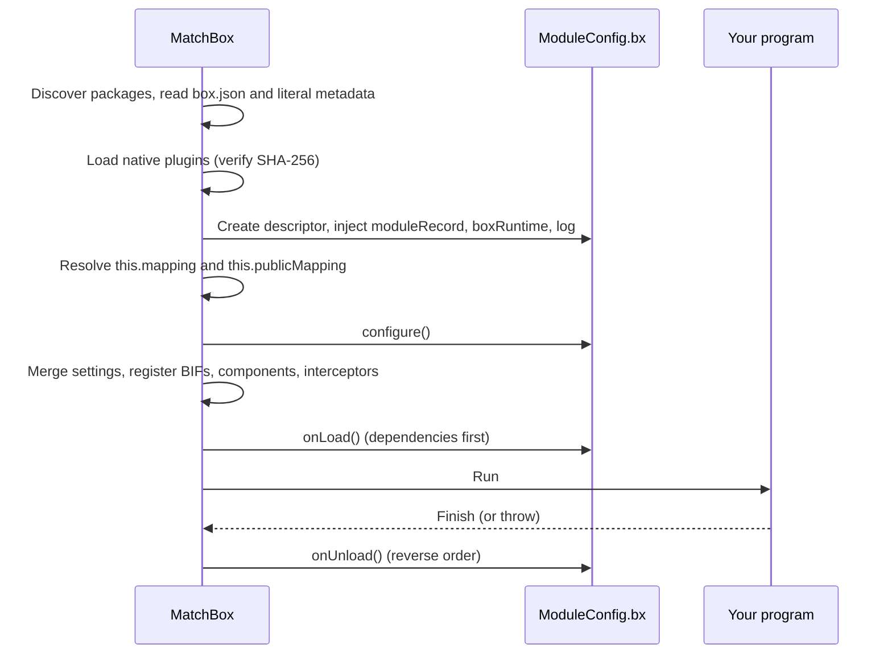

A module goes through four stages: **discovery**, **configuration**, **running** and **unloading**.



## 1. Discovery

Before any module code runs, MatchBox:

- finds packages in the [module locations](using-modules.md#where-matchbox-looks);
- reads `box.json` and the descriptor's literal `this.enabled`, `this.dependencies` and `this.modules`;
- skips disabled modules and their nested modules;
- orders modules so dependencies come first.

A missing dependency or a dependency cycle stops startup with an error, for example `Module greeter requires missing module helper`.

## 2. Configuration

For each module, in dependency order:

1. Native plugins listed in `matchbox.artifacts` are verified and loaded.
2. The descriptor is created, and `moduleRecord`, `boxRuntime`, `log` and the services are injected.
3. `this.mapping` and `this.publicMapping` are resolved, and the module's classes are bound to them.
4. `configure()` runs and fills `settings`, `interceptors`, `customInterceptionPoints` and `classProviders`.
5. The application's settings from `boxlang.json` are deep-merged over the defaults.
6. BIFs, member functions, components, interceptors and class providers are registered.

## 3. Loading

After every module is configured, `onLoad()` runs, dependencies first. A module is marked as activated only after its `onLoad()` succeeds.

```boxlang
function onLoad() {
    log.info( "Ready: #moduleRecord.name#" );
}
```

Nested modules in a module's `modules/` folder are configured and loaded before their parent.

## 4. Unloading

When the program finishes, `onUnload()` runs in reverse order. It also runs when the program ends with an error, so it is a safe place to close connections and files.

```boxlang
function onUnload() {
    variables.pool?.close();
}
```

- Interceptors stay registered during `onUnload()` and are removed afterwards.
- If one `onUnload()` fails, the others still run, and the original error is kept.
- If startup fails part way, modules that were already configured are cleaned up in reverse order.

!!! warning "Process lifetime"
    `onUnload()` runs on a normal exit. It cannot run if the process is killed or crashes. Native libraries stay loaded until the process exits, so there is no hot reload: `boxModuleReload()` throws an error.

## Lifecycle events

MatchBox announces these events automatically. Any interceptor can listen to them:

| Event | When | Data |
| --- | --- | --- |
| `preModuleLoad` | Before a module loads | `moduleRecord`, `moduleName` |
| `postModuleLoad` | After a module loads | `moduleRecord`, `moduleName` |
| `preModuleUnload` | Before a module unloads | `moduleRecord`, `moduleName` |
| `postModuleUnload` | After a module unloads | `moduleRecord`, `moduleName` |
| `preFunctionInvoke` | Before a function runs | context, arguments, function, name |
| `postFunctionInvoke` | After a function returns | the same, plus the result |
| `onFunctionException` | When a function throws | the same, plus the exception |

The data is live: an interceptor can change arguments in `preFunctionInvoke` or the result in `postFunctionInvoke`. See [Interceptors](capabilities/interceptors.md).

## Web servers

The [web server](../building-and-deploying/web-server.md) starts modules before it serves the first request. On shutdown the application ends first, then the modules unload. Web startup is offline: native artifacts must be installed in the package, not referenced by URL.
