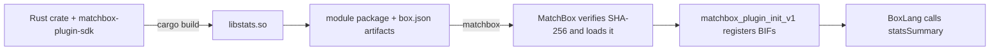

A **native plugin** is a Rust library that a module ships prebuilt. It registers native BIFs and objects that BoxLang code calls like any other function. People who use the module need no Rust, no Cargo and no SDK: the compiled library is part of the package.

::: columns
::: column
**Use a native plugin for**

- speed: parsing, image work, number crunching;
- Rust crates and C libraries;
- operating system APIs: sockets, streams, devices;
- binary data.
:::
::: column
**Stay in BoxLang for**

- wrappers, validation and defaults;
- member functions and components;
- settings, events and lifecycle;
- anything that should also run on WebAssembly or ESP32.
:::
:::

!!! info "Native plugins or Native Fusion?"
    A native plugin belongs to a **module** and is prebuilt once for each platform. [Native Fusion](../../building-and-deploying/native-fusion.md) compiles Rust that belongs to **your application** into its binary. Use plugins to share code with others; use Native Fusion for code only your app needs.

## How it works



1. The plugin is a Rust `cdylib` that exports `matchbox_plugin_init_v1`.
2. At startup MatchBox verifies the library's SHA-256, loads it and calls the init function.
3. The init function asks for the **capabilities** it needs and **registers** its BIFs.
4. BoxLang calls those BIFs. Values cross the boundary through a stable C ABI, never through MatchBox's internal types.

## Build your first plugin

This example builds `bx-stats`, with three functions that take and return arrays and structs.

### 1. Create the crate

```text
bx-stats/
  box.json
  ModuleConfig.bx
  bifs/
  native/
    Cargo.toml
    src/lib.rs
```

```toml
# native/Cargo.toml
[package]
name = "bx-stats-native"
version = "0.1.0"
edition = "2024"

[lib]
crate-type = ["cdylib"]

[dependencies]
matchbox-plugin-sdk = { git = "https://github.com/ortus-boxlang/matchbox", rev = "<commit>" }

[profile.release]
panic = "unwind"
```

!!! note "The SDK dependency"
    The SDK is not on crates.io yet. Depend on it from the MatchBox repository, pinned to a commit. `panic = "unwind"` lets the SDK turn a Rust panic into a BoxLang error instead of ending the process.

### 2. Write the functions

```rust
// native/src/lib.rs
use matchbox_plugin_sdk::*;
use std::ffi::c_void;
use std::sync::OnceLock;

// Capability tables live for the whole process, so keep them after init.
static TYPES: OnceLock<&'static TypesV1> = OnceLock::new();
static COLLECTIONS: OnceLock<&'static CollectionsV1> = OnceLock::new();

fn types() -> Result<&'static TypesV1, String> {
    TYPES.get().copied().ok_or_else(|| "types capability missing".into())
}
fn collections() -> Result<&'static CollectionsV1, String> {
    COLLECTIONS.get().copied().ok_or_else(|| "collections capability missing".into())
}

// Reads a BoxLang array of numbers.
fn numbers(call: &Call<'_>, value: Value) -> Result<Vec<f64>, String> {
    let (t, c) = (types()?, collections()?);
    if call.kind(t, value)? != Kind::Array {
        return Err("values must be an array".into());
    }
    (0..call.array_len(c, value)?)
        .map(|i| call.number(call.array_get(c, value, i)?))
        .collect()
}

// statsSummary( values ): { count, sum, mean, min, max }
unsafe extern "C" fn summary(
    ctx: Context, api: *const ValuesV1, _: *mut c_void,
    args: *const Value, len: usize, out: *mut Value,
) -> i32 {
    unsafe {
        guarded(ctx, api, out, || {
            let call = Call::new(ctx, api, args, len);
            let values = numbers(&call, call.argument(0)?)?;
            let sum: f64 = values.iter().sum();
            let result = call.struct_new()?;
            call.struct_set(result, "count", call.number_new(values.len() as f64)?)?;
            call.struct_set(result, "sum", call.number_new(sum)?)?;
            if !values.is_empty() {
                call.struct_set(result, "mean", call.number_new(sum / values.len() as f64)?)?;
                call.struct_set(result, "min", call.number_new(values.iter().cloned().fold(f64::INFINITY, f64::min))?)?;
                call.struct_set(result, "max", call.number_new(values.iter().cloned().fold(f64::NEG_INFINITY, f64::max))?)?;
            }
            Ok(result)
        })
    }
}

// statsChunk( values, size = 2 ): an array of arrays
unsafe extern "C" fn chunk(
    ctx: Context, api: *const ValuesV1, _: *mut c_void,
    args: *const Value, len: usize, out: *mut Value,
) -> i32 {
    unsafe {
        guarded(ctx, api, out, || {
            let call = Call::new(ctx, api, args, len);
            let c = collections()?;
            let values = numbers(&call, call.argument(0)?)?;
            let size = call.number(call.argument(1)?)? as usize;
            if size == 0 {
                return Err("size must be at least 1".into());
            }
            let rows = call.array_new(c)?;
            for part in values.chunks(size) {
                let row = call.array_new(c)?;
                for n in part {
                    call.array_push(c, row, call.number_new(*n)?)?;
                }
                call.array_push(c, rows, row)?;
            }
            Ok(rows)
        })
    }
}

// statsScale( values, options ): options.factor (default 1) and options.round (a boolean)
unsafe extern "C" fn scale(
    ctx: Context, api: *const ValuesV1, _: *mut c_void,
    args: *const Value, len: usize, out: *mut Value,
) -> i32 {
    unsafe {
        guarded(ctx, api, out, || {
            let call = Call::new(ctx, api, args, len);
            let (t, c) = (types()?, collections()?);
            let values = numbers(&call, call.argument(0)?)?;
            let options = call.argument(1)?;
            let factor = match call.struct_get(c, options, "factor")? {
                Some(v) => call.number(v)?,
                None => 1.0,
            };
            let round = match call.struct_get(c, options, "round")? {
                Some(v) => call.boolean(t, v)?,
                None => false,
            };
            let result = call.array_new(c)?;
            for n in values {
                let x = n * factor;
                call.array_push(c, result, call.number_new(if round { x.round() } else { x })?)?;
            }
            Ok(result)
        })
    }
}
```

### 3. Register them

```rust
#[unsafe(no_mangle)]
pub unsafe extern "C" fn matchbox_plugin_init_v1(host: *const HostV1, ctx: Context) -> i32 {
    unsafe {
        if let Err(status) = require_values(host, ctx) {
            return status;
        }
        match (require_types(host, ctx), require_collections(host, ctx)) {
            (Ok(t), Ok(c)) => {
                let _ = TYPES.set(t);
                let _ = COLLECTIONS.set(c);
            }
            (Err(status), _) | (_, Err(status)) => return status,
        }
        let functions: [(&str, Invoke); 3] = [
            (r#"{"name":"statsSummary","arguments":[{"name":"values","required":true}]}"#, summary),
            (r#"{"name":"statsChunk","arguments":[{"name":"values","required":true},{"name":"size","default":2}]}"#, chunk),
            (r#"{"name":"statsScale","arguments":[{"name":"values","required":true},{"name":"options","required":true}]}"#, scale),
        ];
        for (metadata, invoke) in functions {
            let status = ((*host).register)(ctx, Text::new(metadata), invoke);
            if status != 0 {
                return status;
            }
        }
        0
    }
}
```

The metadata declares each function's name and arguments. MatchBox fills in defaults and maps named arguments before your callback runs. See [SDK Reference](sdk-reference.md#registering-functions).

### 4. Build and package

```sh
cargo build --release --manifest-path native/Cargo.toml
mkdir -p lib/x86_64-unknown-linux-gnu
cp native/target/release/libbx_stats_native.so lib/x86_64-unknown-linux-gnu/
sha256sum lib/x86_64-unknown-linux-gnu/libbx_stats_native.so
```

List the library in `box.json`, under its target:

```json
{
    "name": "Stats",
    "slug": "bx-stats",
    "version": "1.0.0",
    "type": "boxlang-modules",
    "boxlang": { "moduleName": "stats" },
    "matchbox": {
        "artifacts": {
            "x86_64-unknown-linux-gnu": {
                "path": "lib/x86_64-unknown-linux-gnu/libbx_stats_native.so",
                "sha256": "<the sha256 from above>",
                "abi": 1
            }
        }
    }
}
```

```boxlang
// ModuleConfig.bx
class {
    function configure() {}
}
```

### 5. Call it from BoxLang

```boxlang
println( statsSummary( [ 3, 1, 4, 1, 5 ] ) );
// {"count":5.0,"max":5.0,"mean":2.8,"min":1.0,"sum":14.0}

println( statsChunk( [ 1, 2, 3, 4, 5 ] ) );             // [[1,2],[3,4],[5]]
println( statsChunk( values = [ 1, 2, 3, 4, 5 ], size = 3 ) ); // [[1,2,3],[4,5]]
println( statsScale( [ 1.4, 2.6 ], { factor: 2, round: true } ) ); // [3,5]
```

```sh
matchbox --module ./bx-stats app.bxs
```

Errors returned from Rust become BoxLang exceptions:

```boxlang
try {
    statsSummary( "nope" );
} catch ( any e ) {
    println( e.message ); // values must be an array
}
```

### 6. Add BoxLang on top

Keep the native surface small, and add the friendly parts in BoxLang. A class BIF can add a member function:

```boxlang
// bifs/Average.bx
@BoxMember( "array" )
class {
    function invoke( required array values ) {
        return statsSummary( arguments.values ).mean;
    }
}
```

```boxlang
println( [ 2, 4, 6 ].average() ); // 4
```

### 7. Ship it in a binary

```sh
matchbox --module ./bx-stats --target native --output stats-app app.bxs
./stats-app
```

The library is embedded in `stats-app`. At startup it is unpacked to a private, verified cache. See [Artifacts](artifacts.md#the-native-cache).

## Next steps

- [SDK Reference](sdk-reference.md): registration, every `Call` helper and the capabilities.
- [Native Objects](native-objects.md): return Rust state with methods, and keep values between calls.
- [Artifacts](artifacts.md): targets, bundled shared libraries, the cache and security.
- [Dual Modules](../dual-modules.md): one package for MatchBox and the JVM.
